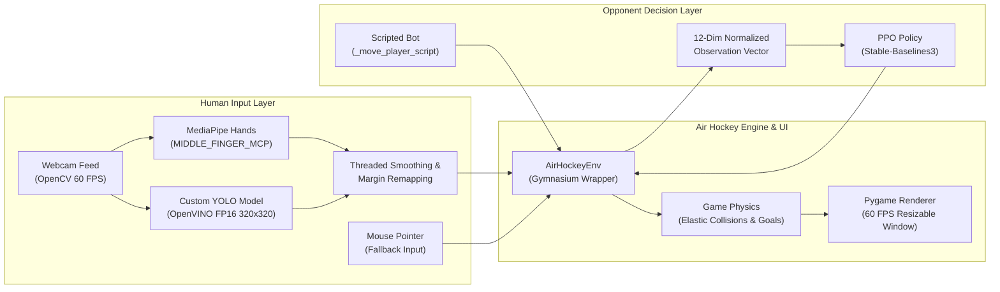

# gestureAppControl — Vision-Controlled Air Hockey & Reinforcement Learning AI

[](https://www.python.org/)
[](https://www.pygame.org/)
[](https://opencv.org/)
[](https://developers.google.com/mediapipe)
[](https://docs.ultralytics.com/)
[](https://stable-baselines3.readthedocs.io/)

An interactive Air Hockey game combining **real-time webcam hand-gesture tracking** with a **Reinforcement Learning (PPO) opponent**. Play touch-free using either **Google MediaPipe Hands** or a **custom-trained YOLO detector accelerated with Intel OpenVINO**, or challenge the AI with a mouse—and train or evaluate custom PPO agents inside the included Gymnasium environment.

---

## Key Features

- **Dual Webcam Hand-Tracking Backends**:
  - **MediaPipe Hands (`gesture_controll.py`)**: Tracks the `MIDDLE_FINGER_MCP` landmark from 21 3D hand keypoints (`conf=0.7`, active margin `20%`).
  - **Custom YOLO + Intel OpenVINO Model (`gesture_controll_own_model.py`, `best_openvino_model/`)**: Runs an FP16 OpenVINO-exported Ultralytics YOLO detector (`320×320`, class `0: Hand raise`, `conf=0.25`, active margin `15%`) and tracks the bounding-box center.
  - Both trackers run asynchronously in background daemon threads with frame-buffer flushing and exponential smoothing (`smoothing_factor = 0.4`) for responsive, low-jitter mallet control.
- **Reinforcement Learning Air Hockey Environment (`air_hockey_env.py`)**:
  - Custom `gymnasium.Env` with a continuous 2D velocity action space `Box(-1, 1, shape=(2,))` and a 12-dimensional normalized state observation vector (puck, AI mallet, and opponent positions & velocities).
  - Shaped reward function incentivizing goal scoring, defensive shadowing behind the puck, high-speed goal-aligned strikes, and penalizing own-goals, idling, multi-hit spamming, and wall-hugging.
  - Pre-trained **Stable-Baselines3 PPO** checkpoints included (`bestOneYet.zip` plus progressive checkpoints from `2.78M` to `10.43M` timesteps).
- **Interactive Menu & 2D Physics Engine (`main.py`, `Game.py`)**:
  - Resizable Pygame UI (`1280×720` default, minimum `700×400`) to pick opponent (`Wyuczone AI` vs. `Skryptowany Bot`), input (`Myszka` vs. `Ręka (Kamera)`), and hand-tracking backend (`MediaPipe` vs. `Własny Model`).
  - Circle-circle elastic impulse collisions (`restitution = 1.0`) with overlap resolution, puck friction, wall bounces, center-line restrictions, and live scoreboard.

---

## Architecture & Pipeline



---

## Tech Stack

| Category | Technologies |
| :--- | :--- |
| **Language** | Python 3.10+ |
| **Computer Vision** | OpenCV (`opencv-python`), MediaPipe (`0.10.11`), Ultralytics YOLO (`8.4.25`), Intel OpenVINO (`2026.0.0`) |
| **Reinforcement Learning** | Gymnasium (`1.2.3`), Stable-Baselines3 (`2.7.1`, PPO `MlpPolicy`), PyTorch (`2.10.0`), TensorBoard |
| **Game & Rendering** | Pygame (`2.6.1`), NumPy (`2.4.2`) |

---

## Project Structure

```text
gestureAppControl/
├── main.py                         # Main Pygame app with interactive menu (AI/Bot, Mouse/Hand, MediaPipe/OpenVINO)
├── gesture_controll.py             # Threaded HandTracker using MediaPipe Hands
├── gesture_controll_own_model.py   # Threaded HandTracker using custom OpenVINO YOLO model (also runnable standalone)
├── best_openvino_model/            # Exported Ultralytics YOLO OpenVINO IR model (best.xml, best.bin, metadata.yaml)
├── air_hockey_env.py               # Custom Gymnasium environment (12-dim obs, 2-dim continuous action, shaped rewards)
├── train.py                        # Train PPO agent from scratch (saves to models/PPO/ & logs/)
├── resume_train.py                 # Resume PPO training from a specified checkpoint step
├── test.py                         # Watch trained PPO model (bestOneYet.zip) play against scripted bot
├── play_vs_ai.py                   # Direct mouse-controlled Human vs. PPO AI match script
├── Game.py                         # Core game loop, scripted bots, elastic collision & goal detection
├── Board.py                        # Rink geometry, goal recesses & dashed markings
├── Player.py                       # Mallet state & movement handlers (mouse, hand tracker, AI velocity step)
├── Puck.py                         # Puck kinematics, friction & wall reflections
├── Score.py                        # Scoreboard rendering
├── Screen_helper.py                # Shared display surface & resize state manager
├── UI_settings.py                  # Colors, proportions & default window size (1280x720)
├── bestOneYet.zip                  # Pre-trained PPO agent checkpoint (plus 2.78M–10.43M milestone zips)
└── requirements.txt                # Pinned Python dependencies
```

---

## Getting Started

### Prerequisites

- **Python 3.10+**
- A working **webcam** (required only for hand-gesture control mode; mouse mode works without a camera)

### Installation

```bash
# 1. Clone the repository
git clone https://github.com/Dudek03/gestureAppControl.git
cd gestureAppControl

# 2. Create and activate a virtual environment
python -m venv .venv
# Windows (PowerShell):
.venv\Scripts\Activate.ps1
# Linux / macOS:
source .venv/bin/activate

# 3. Install dependencies
pip install -r requirements.txt
```

---

## Usage

### 1. Launch the Full Game (Menu + Hand/Mouse Control)

```bash
python main.py
```

In the startup menu:
1. Choose **Opponent**: `Wyuczone AI` (loads `bestOneYet.zip` PPO policy) or `Skryptowany Bot`.
2. Choose **Control**: `Myszka` (Mouse) or `Ręka (Kamera)` (Webcam).
3. If using the camera, choose **Hand Detection Model**: `MediaPipe` or `Własny Model` (custom OpenVINO YOLO).
4. Click **`START MECZU`** to play. You control the **left mallet**; the AI/bot controls the **right mallet**.

### 2. Test the Custom OpenVINO Hand Tracker Standalone

Verify webcam capture and live screen-mapped coordinates in the terminal without launching the game:

```bash
python gesture_controll_own_model.py
```

### 3. Train, Resume, or Evaluate the PPO Agent

```bash
# Train a new PPO model from scratch (checkpoints every 10,000 steps to models/PPO/)
python train.py

# Monitor training curves in TensorBoard
tensorboard --logdir logs

# Resume training from a checkpoint (configure STARTING_STEP inside resume_train.py)
python resume_train.py

# Watch the pre-trained PPO model play against the scripted bot
python test.py

# Direct Mouse vs. AI match (update model_path inside play_vs_ai.py if needed)
python play_vs_ai.py
```

### Platform Notes

- **Camera backend**: `gesture_controll_own_model.py` opens the webcam with `cv2.CAP_DSHOW` (Windows DirectShow), while `gesture_controll.py` uses default `cv2.VideoCapture(0)` (macOS/Linux; switch to `CAP_DSHOW` on Windows if webcam startup is slow).
